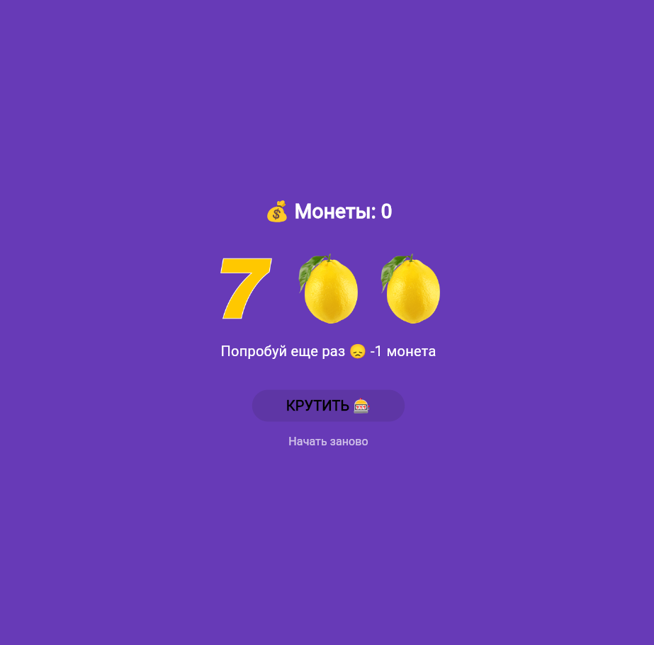

# Лабораторная работа №9. Flutter: StatefulWidget и управление состоянием  
**ФИО** Бараков Олег Юрьевич  
**Группа** ИСП-241  
**Дата** 08.11.2026  
## Что изучили
- изучил разницу между StatelessWidget и StatefulWidget  
- научился управлять состоянием приложения через setState()  
- подключил локальные изображения и обрабатывал нажатия кнопок  
## Скриншот финального приложения
  
## Инструкция по запуску
1. Клонируйте репозиторий и перейдите в папку проекта:
```bash
git clone https://github.com/0lba/Flutter_Lab9
cd slot_machine_barakov
```
2. Установите зависимости:
```bash
flutter pub get
```
3. Запустите приложение в браузере Chrome:
```bash
flutter run -d chrome
```